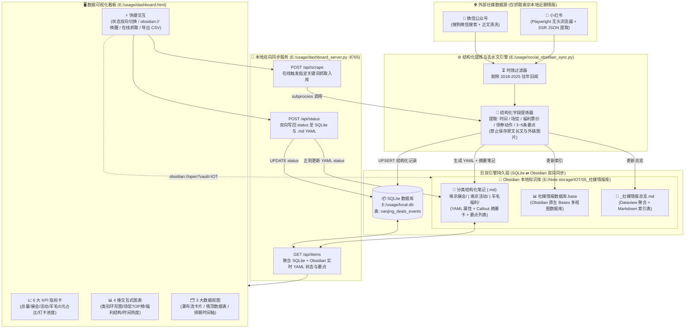

# 南京社媒情报库（展会/活动/羊毛）全栈架构规范与 AI 协作 Prompt

> **用途说明**：本文件包含完整的 **Mermaid 架构图源码**、**核心数据表与文件契约（Schema Contract）**、**接口规范** 以及 **可直接复制给 Cursor / Claude / ChatGPT 的标准化 System Prompt**。

---

## 一、Mermaid 全景架构图源码



---

## 二、核心表结构与文件契约（Schema Contract）

### 1. SQLite 核心表结构 (`E:\usage\local.db` -> `nanjing_deals_events`)

```sql
CREATE TABLE IF NOT EXISTS nanjing_deals_events (
    post_id TEXT PRIMARY KEY,      -- 唯一主键 (如 wx_6325107a0b08, xhs_68f09c12...)
    platform TEXT,                 -- 来源平台: '微信公众号' | '小红书'
    category TEXT,                 -- 三大核心分类: '🎪 南京展会' | '🎉 南京活动' | '🐑 羊毛福利'
    title TEXT,                    -- 提炼后的标题
    author TEXT,                   -- 公众号名称或小红书博主名
    publish_date TEXT,             -- 发布日期 (YYYY-MM-DD)
    event_time TEXT,               -- 活动排期或优惠券有效时间
    location TEXT,                 -- 南京具体场馆、街区或领券渠道
    benefit TEXT,                  -- 核心福利/票价 (如: 免费免票 / 0元抽奖 / 满减消费券)
    action_guide TEXT,             -- 一句话操作指引 (如: 公众号预约 / 支付宝搜口令)
    summary TEXT,                  -- 120字以内高密度省流总结 (严禁存原文长文)
    url TEXT,                      -- 原帖链接
    obsidian_path TEXT,            -- 对应 Obsidian 笔记相对路径 (如 05_社媒情报库/南京展会/xxx.md)
    status TEXT,                   -- 执行状态: '待去/待薅' | '已打卡/已薅' | '已过期'
    fetched_at TEXT                -- 入库时间戳 (YYYY-MM-DD HH:MM:SS)
);
```

### 2. Obsidian 笔记 YAML Frontmatter 契约 (`05_社媒情报库/<分类>/<标题>.md`)

> **重要约束**：笔记正文**严禁包含外链图片 ``**（防止触发 Obsidian `obsidian-local-images-plus` 插件向 `图片资源/` 乱下无关图片），且**严禁堆砌原文长文**。

```markdown
---
title: "笔记标题"
category: "🎪 南京展会"          # 枚举: 🎪 南京展会 | 🎉 南京活动 | 🐑 羊毛福利
platform: "微信公众号"           # 枚举: 微信公众号 | 小红书
author: "来源账号"
publish_date: 2026-10-20
event_time: "2026年10月18日—10月22日"
location: "南京国际博览中心（建邺区江东中路300号）"
benefit: "免费领票入场（现场领茶礼）"
action_guide: "官方公众号免费领电子门票"
status: "待去/待薅"              # 枚举: 待去/待薅 | 已打卡/已薅 | 已过期
summary: "一句话高密度省流总结"
source_url: "https://..."
post_id: "wx_xxxxxxxxxxxx"
tags:
  - 社媒情报
  - 南京本地
  - 南京展会
---

> [!abstract] ⚡ 一句话省流总结
> **一句话总结内容**
> - ⏰ **活动/有效时间**：`...`
> - 📍 **地点/范围**：`...`
> - 🎁 **福利/票价**：`...`
> - 🚀 **参与方式**：`...`
> - 🔗 **原帖链接**：[点击打开原网页](https://...)

## 📋 核心要点提炼
- 要点 1（45字内精炼干货）
- 要点 2
- 要点 3
```

### 3. 本地 HTTP 接口契约 (`http://127.0.0.1:8765`)

| 方法 | 路径 | 请求体 (JSON) | 响应体 (JSON) | 说明 |
| :--- | :--- | :--- | :--- | :--- |
| `GET` | `/` | - | `text/html` | 返回可视化看板页面 `E:\usage\dashboard.html` |
| `GET` | `/api/items` | - | `{"ok": true, "count": 15, "items": [...]}` | 合并读取 SQLite 字段 + Obsidian `.md` 中的 `key_points` 与最新 `status` + `obsidian_uri` |
| `POST` | `/api/status` | `{"post_id": "wx_...", "status": "已打卡/已薅"}` | `{"ok": true, "post_id": "...", "status": "..."}` | **双向同步**：同时更新 `local.db` 和对应 Obsidian `.md` 的 YAML `status` |
| `POST` | `/api/scrape` | `{"keyword": "南京漫展", "limit": 2}` | `{"ok": true, "stdout": "...", "count": 17, "items": [...]}` | 在线调用 `social_obsidian_sync.py` 增量抓取并刷新数据 |

---

## 三、可直接复制给其他 AI 的标准化系统提示词（Prompt）

> 📋 **使用方法**：复制下方代码块中的全部内容，直接粘贴给 Cursor / Claude / ChatGPT，并在最后加上你的新需求即可。

```markdown
# Role & Project Context
你现在接手一个已稳定运行的「南京本地社媒情报抓取、结构化提炼与 Obsidian/SQLite 双向可视化系统」。
请在后续开发中严格遵守以下架构边界、文件路径、数据表契约与设计约束。

## 1. 核心业务目标与铁律
1. **聚焦领域**：只处理南京地区的三大类情报：
   - `🎪 南京展会`（国博、规划馆、博物馆、美术馆、漫展、车展等）
   - `🎉 南京活动`（音乐会、戏剧节、咖啡节、周末市集、夜游演出等）
   - `🐑 羊毛福利`（南京消费券、地铁公交乘车优惠、0元霸王餐、免票福利等）
2. **拒绝原文堆砌（核心铁律）**：用户不看长篇水文。入库数据必须提炼为结构化字段（`event_time`, `location`, `benefit`, `action_guide`, `summary`）+ 3~5 条 45 字以内的核心要点（`key_points`）。
3. **禁止写入外链图片**：Obsidian 仓库开启了 `obsidian-local-images-plus` 插件，任何 `.md` 文件中的 `` 外链图片都会被自动下载并污染 `E:\Note storage\IOT\图片资源\`。因此生成 Markdown 笔记时严禁插入外链图片标签。
4. **时效过滤**：拒绝 2018–2025 往年过期旧闻，仅保留当期（2026）有效情报。

## 2. 关键文件路径清单
- **Python 环境**：`C:\ProgramData\anaconda3\python.exe`（本地代理：`http://127.0.0.1:7897`）
- **抓取与结构化入库脚本**：`E:\usage\social_obsidian_sync.py`
  - 支持参数：`--keyword <自定义词>`、`--limit <每词抓取条数>`、`--rebuild`（清空重建）
- **SQLite 数据库**：`E:\usage\local.db`（核心表名：`nanjing_deals_events`）
- **双向同步 Web 后端**：`E:\usage\dashboard_server.py`（监听 `http://127.0.0.1:8765`）
- **前端数据可视化看板**：`E:\usage\dashboard.html`（内置 `FALLBACK_ITEMS` 离线快照，支持直接双击打开或通过 `:8765` 实时交互）
- **Obsidian 知识库根目录**：`E:\Note storage\IOT`
  - 情报主目录：`E:\Note storage\IOT\05_社媒情报库`
  - 原生数据库视图：`E:\Note storage\IOT\05_社媒情报库\社媒情报数据库.base`
  - 总览索引页：`E:\Note storage\IOT\05_社媒情报库\_社媒情报总览.md`
  - 分类子目录：`南京展会/`、`南京活动/`、`羊毛福利/`

## 3. 数据库 Schema (`nanjing_deals_events`)
字段列表：`post_id` (PK), `platform`, `category`, `title`, `author`, `publish_date`, `event_time`, `location`, `benefit`, `action_guide`, `summary`, `url`, `obsidian_path`, `status`, `fetched_at`。
- `status` 合法枚举值：`待去/待薅` | `已打卡/已薅` | `已过期`。
- 任何对 `status` 或其它字段的修改，必须保证 SQLite (`local.db`) 与 Obsidian 对应 `.md` 文件的 YAML Frontmatter 保持双向一致。

## 4. 前后端技术约束
- 前端 `E:\usage\dashboard.html` 采用原生零外部 CDN 依赖方案（纯 HTML5 + CSS3 + 原生 SVG 图表 + 原生 `<dialog>` 弹窗 + 响应式 Sticky Table），确保断网或代理切换时 100% 正常渲染。
- 修改数据或新增字段后，可重新将 `dashboard_server.get_all_items()` 的 JSON 注入 `dashboard.html` 的 `FALLBACK_ITEMS` 常量，保持离线双击可用性。

---
请确认你已理解以上架构与契约。我接下来的具体需求是：
【在这里输入你的新需求，例如：增加高德/百度地图坐标打点视图、增加定时自动抓取任务、或者新增某类特定羊毛筛选规则】
```
