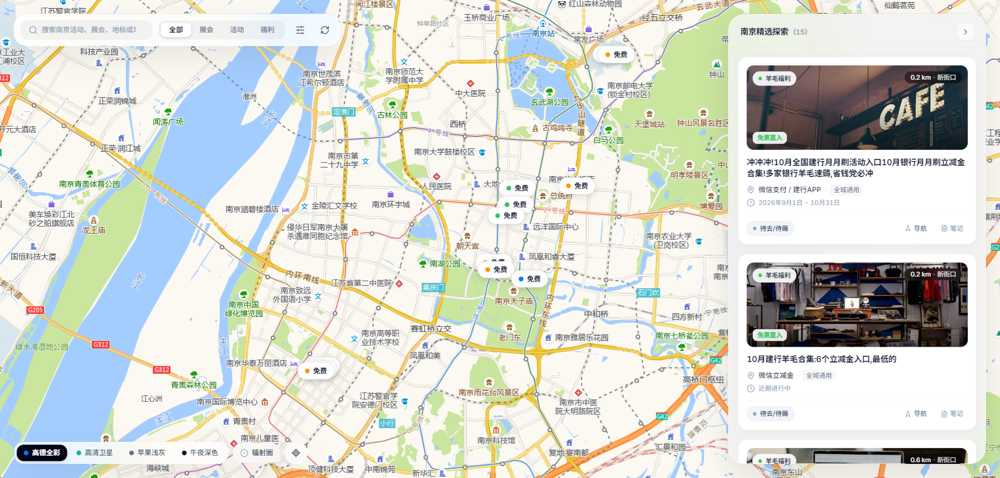

# 南京同城活动情报与时空探索看板 (Nanjing Events LBS & Apple Spatial Dashboard)

> 基于 **Apple HIG 官方规范（Apple macOS Sonoma & Airbnb 空间探索美学）** 与 **高德地图原生图源** 构建的南京同城活动、展会与羊毛福利时空情报探索平台。



---

## 🌟 设计与交互哲学

本项目彻底摒弃了传统后台管理系统的重型侧边栏与面包屑，1:1 还原现代潮流探索应用（Airbnb / Apple Maps Guides）的空间交互美学：

1. **功能层与内容层分离（Liquid Glass 架构）**：
   - **功能控制层**：采用磨砂亚克力玻璃（`bg-[#F5F5F7]/85`、`backdrop-blur-2xl`、`rounded-[28px]`、`border border-white/80`、`shadow-[0_20px_50px_rgba(0,0,0,0.1)]`）。
   - **内容数据层**：采用纯白实体 Apple Card（`bg-white`、`rounded-2xl`、`border border-black/[0.04]`），绝不在内容卡片上滥用毛玻璃，保证极高阅读舒适度。
2. **通透浮动岛（Floating Island）**：
   - 顶部悬浮搜索与 iOS 分段胶囊脱离屏幕死板边缘，四边留白，支持全城 11 个行政区与 3km/5km/10km 半径极速过滤。
3. **Bento Grid 潮流活动卡片**：
   - 潮流封面图（`rounded-xl`），叠加磨砂类别胶囊、新街口等宽距离标签（`font-variant-numeric: tabular-nums`）与免票直入徽标。
   - 标题严格采用 `font-semibold text-slate-900`。
4. **Airbnb 交互药丸打点（Interactive Marker Pills）**：
   - 默认态为纯白悬浮药丸胶囊，带语义色彩小圆点（展会橙 `#FF9500`、福利绿 `#34C759`、活动蓝 `#007AFF`）。
   - 选中激活态反转为纯黑高亮药丸（`bg-slate-950 text-white`），辅以物理弹簧放大动效（`cubic-bezier(0.34, 1.56, 0.64, 1)`）。

---

## 🗺️ 高德地图深度空间功能 (Gaode Spatial Studio)

* **默认高德全彩标准**：直连高德官方国内瓦片集群（`webrd01~04.is.autonavi.com`），无需第三方商业 Key，无水印，原生 GCJ-02 火星坐标精准对齐，<20ms 超低延迟。
* **4 模地图引擎**：
  * **高德全彩**：默认标准彩色，清晰呈现南京全城商圈、水系与路网。
  * **高清卫星**：遥感实景卫星影像 + 半透明道路地标标注。
  * **苹果浅灰**：Apple Whitesmoke 极简灰度调色。
  * **午夜深色**：macOS 极夜反色滤镜，沉浸感暗黑体验。
* **新街口同心辐射圈**：一键开启 3km 核心商圈、5km 主城圈、10km 绕城圈同心雷达。
* **行政区平滑巡航**：全城 11 区（玄武、秦淮、建邺、鼓楼、栖霞、雨花台、江宁、浦口、六合、溧水、高淳）镜头自动平滑飞行动画。
* **高德官方导航 URI**：直通 `https://uri.amap.com/marker`，一键调起高德官方导航。

---

## 🔄 双向数据与 Obsidian 本地联动

* **SQLite 本地库**：`local.db` 存储结构化空间数据，包含 GCJ-02 坐标、距离、分类、核销状态等。
* **Obsidian 双向核销**：
  * 在看板上点击状态胶囊（`待去/待薅` ➔ `已完成` ➔ `已过期`），不仅即时更新 SQLite，更双向写回本地 Obsidian Markdown 文档的 Frontmatter YAML。
  * 卡片自带 `obsidian://open?vault=...` 深度协议链接，一键跳转本地笔记。

---

## 🚀 快速启动

### 运行环境
- Python 3.10+
- Node.js 18+ (如需前端二次开发)

### 1. 启动本地全功能服务
```bash
python dashboard_server.py
```
访问 `http://127.0.0.1:8765/` 即可直接体验。

### 2. 前端工程开发与构建（可选）
```bash
cd frontend
npm install
npm run dev   # 开发调试
npm run build # 生产打包至 dist/
```

### 3. 免打包单文件独立运行
如果需要在任意无 Node 环境的机器上运行，直接双击或由浏览器打开：
```bash
python generate_apple_dashboard.py
# 生成独立的 dashboard.html，双击即可全屏沉浸浏览
```

---

## 📁 核心架构与目录

```
E:\usage
├── frontend/                     # Vue 3 + Vite + Tailwind 前端工程
│   ├── src/
│   │   ├── App.vue               # Apple HIG & Airbnb 空间探索核心组件
│   │   └── main.js
│   ├── dist/                     # 生产打包产物
│   └── package.json
├── dashboard_server.py           # 本地 HTTP + REST + Obsidian 桥接后端
├── generate_apple_dashboard.py   # 单文件免编译 Apple Dashboard 生成器
├── nanjing_lbs_engine.py         # 南京各区坐标原点与空间测距计算核心
├── social_obsidian_sync.py       # 社媒情报库与 Obsidian 增量双向同步引擎
├── dashboard.html                # 独立单文件看板
├── local.db                      # 本地 SQLite 空间数据库
└── README.md
```

---

## 📄 许可证
MIT License
